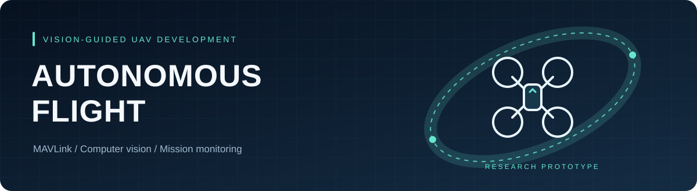
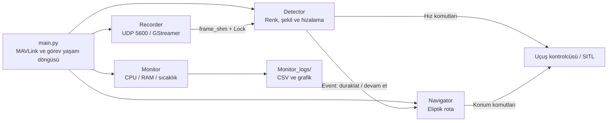

<p align="center">
  
</p>

<p align="center">
  <strong>Görüntü işleme destekli otonom İHA görev prototipi</strong><br>
  Python · MAVLink · OpenCV · GStreamer · Multiprocessing
</p>

<p align="center">
  <a href="#hızlı-başlangıç">Kurulum</a> ·
  <a href="#çalışma-akışı">Çalışma akışı</a> ·
  <a href="#örnekler">Örnekler</a> ·
  <a href="#mevcut-sınırlar">Mevcut sınırlar</a> ·
  <a href="CONTRIBUTING.md">Katkı rehberi</a>
</p>

Bu proje, MAVLink bağlantısı üzerinden kalkış ve rota komutları gönderen; video akışında renk ve şekil tabanlı hedefler arayan bir Python uygulamasıdır. Görüntü alımı, hedef tespiti, rota takibi ve performans izleme ayrı süreçlerde çalışır.

**Durum: geliştirme prototipi.** `main.py` çalıştırıldığında bağlantı kurduğu araca parametre, arm ve kalkış komutları gönderir. Kamera ve görev süreçlerinin başlatılması kalkış çağrısından sonra gelir. Donanımsız inceleme için aşağıdaki test ve kamera örneklerini kullanın. Bu repo uçuş doğrulaması yapıldığını iddia etmez.

## Neler içeriyor?

- **Görev akışı:** STABILIZE → GUIDED, arm, kalkış, rota ve LAND komutları.
- **Eliptik rota:** Yerel NED koordinatlarında, döndürülmüş bir elips üzerinde 800 konum örneği.
- **Hedef arama:** HSV renk maskeleri, kontur alanı filtresi, üçgen ve altıgen şekil kontrolü.
- **Görüntüye göre hizalama:** Hedefin görüntü merkezinden sapmasına bağlı gövde eksenli hız komutları.
- **Video paylaşımı:** UDP/RTP H.264 akışının GStreamer ile alınması ve paylaşımlı belleğe aktarılması.
- **Performans kaydı:** Süreç başına CPU/RAM ölçümü, sıcaklık okuması, CSV ve grafik üretimi.

Yük bırakma için yalnızca mesaj ve sayaç akışı bulunur. `trigger_relay()` boş bir yer tutucudur; fiziksel bırakma uygulanmamıştır. `recording_video.py` adına rağmen video dosyası kaydetmez, kareleri diğer süreçle paylaşır.

## Çalışma akışı



Dört alt süreç `Barrier(4)` üzerinden başlangıçta eşzamanlanır. Hedef tespit süreci bir `Event` ayarladığında rota süreci bekler; olay temizlendiğinde rota komutlarına devam eder. Ana süreç normal tamamlanmada LAND, kayıtlı sinyal işleyicisi ise RTL komutu gönderir.

## Proje düzeni

```text
autonomous-flight/
├── autonomous_flight_Py/
│   ├── main.py                 # Görev başlangıcı ve HSV kontur çıkarımı
│   ├── route_tracking.py       # Eliptik rota örnekleme ve takip
│   ├── target_detection.py     # Hedef arama ve merkezleme
│   ├── recording_video.py      # GStreamer ve paylaşımlı görüntü belleği
│   ├── process_monitor.py      # Kaynak kullanımı kaydı ve çizimi
│   └── utils.py                # MAVLink yardımcıları
├── examples/
│   ├── webcam_detection.py     # Yerel kamerada maske/kontur önizlemesi
│   └── stream_preview.py       # UDP video akışı önizlemesi
├── tests/                      # Sentetik görüntü ve rota testleri
├── docs/assets/banner.svg
├── .github/                    # CI ve katkı şablonları
├── requirements-core.txt       # GStreamer ortamıyla ortak bağımlılıklar
├── requirements.txt            # Masaüstü OpenCV dahil geliştirme bağımlılıkları
└── CONTRIBUTING.md
```

Yerel sanal ortamlar, IDE ayarları, üretilen kayıtlar ve eski iç içe `autonomous_flight/` kopyası Git dışında tutulur. Asıl kaynak dizini `autonomous_flight_Py/` klasörüdür.

## Hızlı başlangıç

Geliştirme ve birim testleri için Python **3.11–3.13** kullanın. CI yapılandırması Windows ve Linux üzerinde Python 3.11 ve 3.13 çalıştıracak şekilde hazırlanmıştır; bu, uçuş ortamının doğrulandığı anlamına gelmez.

Depoyu GitHub hesabınızla erişim sağlayarak klonlayın:

```bash
git clone https://github.com/Emir-Gemici/autonomous-flight.git
cd autonomous-flight
```

Repo kökünde bir sanal ortam oluşturun:

```bash
python -m venv .venv
```

Windows / PowerShell:

```powershell
.\.venv\Scripts\Activate.ps1
```

Linux / macOS:

```bash
source .venv/bin/activate
```

Bağımlılıkları yükleyip donanım gerektirmeyen testleri çalıştırın:

```bash
python -m pip install -r requirements.txt
python -m unittest discover -s tests -v
```

Testler sentetik görüntüler ve sahte rota komut alıcısı kullanır; kamera açmaz, MAVLink bağlantısı kurmaz ve araca komut göndermez. Bağımlılık dosyaları sürüm aralıkları içerir; sabitlenmiş bir uçuş ortamı kilit dosyası değildir.

### GStreamer kullanan görev ortamı

Görev akışı `cv2.CAP_GSTREAMER` kullanır. Kurulu OpenCV'nin bu desteği içerdiğini kontrol edin:

```bash
python -c "import cv2; print(cv2.getBuildInformation())"
```

Çıktıda **`GStreamer: YES`** bulunmalıdır. Ayrıca GStreamer tarafında `udpsrc`, `rtph264depay`, `avdec_h264`, `videoconvert` ve `appsink` öğeleri bulunmalıdır. `opencv-python` ile masaüstü geliştirme kurulumu yapmak bu koşulun sağlandığını göstermez; [OpenCV paketinin özel derleme açıklamalarına](https://github.com/opencv/opencv-python#manual-builds) bakın.

GStreamer destekli `cv2` sistem Python'unda hazırsa aynı yorumlayıcıyla ayrı bir ortam oluşturabilirsiniz:

```bash
python3 -m venv --system-site-packages .venv-flight
source .venv-flight/bin/activate
python -m pip install -r requirements-core.txt
python -c "import cv2; print(cv2.getBuildInformation())"
```

Bu ortamda `requirements.txt` kurmak sistemdeki GStreamer destekli `cv2` yerine pip paketinin kullanılmasına yol açabilir. OpenCV/NumPy uyumunu ve etkin derlemeyi ayrıca doğrulayın.

## Örnekler

**Webcam ile görüntü işleme:** Kamera `0` açılır; maske, kontur ve merkez bilgileri gösterilir. `q` ile çıkılır. Uçuş kontrolcüsüne bağlanmaz.

```bash
python examples/webcam_detection.py
```

**UDP video önizlemesi:** GStreamer destekli OpenCV ile `5600` portundan H.264/RTP video alır. Bir göndericinin bu porta yayın yapması gerekir. Uçuş kontrolcüsüne bağlanmaz.

```bash
python examples/stream_preview.py
```

**Kayıt grafiği:** Görev sırasında oluşan son CSV dosyasını okur. Komutu, `Monitor_logs/` klasörünün bulunduğu çalışma dizininde çalıştırın. Repo kökünde çalıştırılmış bir görev için:

```bash
python -c "from autonomous_flight_Py.process_monitor import plot_system_monitor; plot_system_monitor()"
```

Grafik aynı klasöre PNG olarak kaydedilir ve ekranda açılır. Eski makineye ait CSV/PNG çıktıları repoya dahil değildir.

## Görev ayarları ve çalıştırma

Ayarlar şu an kaynak dosyalarda sabittir; CLI veya `.env` yapılandırması yoktur.

- `main.py`: MAVLink adresi `udp:127.0.0.1:14550`, irtifa `15 m`, görüntü `1280 × 720`, işleme hızı `12 FPS`; `WPNAV_SPEED_UP=700`, `WPNAV_SPEED_DN=200`, `LAND_SPEED=75`.
- `route_tracking.py`: başlangıç `(0, 0)`, elips yarı eksenleri `130 m` ve `65 m`, `800` örnek ve `90°` dönüş. Örnekler arasında normalde `0.30 s`, ilk duraklamadan sonra `0.25 s` beklenir; bu değerler gerçek araç hızının ölçümü değildir.
- `recording_video.py`: UDP portu `5600`; beklenen kare boyutu `main.py` ile aynı olmalıdır.
- `main.py` / `target_detection.py`: HSV aralıkları, kontur alanı filtresi, sınır ve hizalama eşikleri.
- `process_monitor.py`: ölçüm aralığı `2.5 s`; sıcaklık dosyası `/sys/class/thermal/thermal_zone6/temp`.

`main.py` çalıştırıldığında yalnızca önizleme açılmaz; otomatik görev başlar. Mevcut uygulamanın uçuşa ilişkin sınırlarını aşağıda inceleyin. SITL doğrulaması için MAVLink ve video kaynaklarını hazırladıktan sonra repo kökünden kullanılan giriş noktası:

```bash
python autonomous_flight_Py/main.py
```

Uygulama heartbeat bekler, uçuş parametrelerini yazar, GUIDED/arm/kalkış komutlarını gönderir ve ardından alt süreçleri başlatır. Bağlantı beklemesinde timeout yoktur. Araç modları ve komutları [ArduPilot Copter GUIDED davranışına](https://ardupilot.org/dev/docs/copter-commands-in-guided-mode.html) göre değerlendirilmelidir.

## Mevcut sınırlar

- **Komut doğrulaması eksik:** Kalkış, mod değişimi ve iniş için ACK/telemetri ile başarı doğrulaması yapılmaz; sabit beklemeler kullanılır.
- **Çok süreçli MAVLink:** Aynı bağlantı nesnesi alt süreçlere aktarılır. Windows/macOS `spawn` ve Python 3.14+ POSIX başlangıç yöntemi değişiklikleri için bu tasarım doğrulanmamıştır. Süreçler arasında eşzamanlı gönderim de ayrıca ele alınmalıdır. [Python süreç başlatma yöntemleri](https://docs.python.org/3/library/multiprocessing.html#contexts-and-start-methods).
- **Başlangıçta hata yönetimi:** Kamera açılamazsa diğer süreçler bariyerde bekleyebilir. Kamera kontrolü ve sinyal işleyicilerinin kaydı kalkış çağrısından sonra yapılır.
- **Kare doğrulaması:** Kayıt/paylaşım süreci `camera.read()` sonucunu ve kare boyutunu belleğe yazmadan önce doğrulamaz. Beklenen boyutta olmayan veya kesilen video akışı hataya neden olabilir.
- **Hedef kaybı:** Hedef merkezlenmeden kaybolursa olay temizlenmeyebilir ve rota beklemede kalabilir. İlk aramada kırmızı/mavi maskeler birleştirildiği için renk ile şekil eşleşmesi ayrıca doğrulanmaz.
- **Rota ve bırakma:** `infinity_flight()` adı korunmuştur ancak mevcut rota bir elipstir. Bırakma mesajı fiziksel röle komutuna karşılık gelmez.
- **Kapanış:** Hatalar çoğunlukla yazdırılır; tüm süreçleri, kamerayı ve belleği kapsayan ortak bir kapanış/failsafe akışı yoktur.
- **Ölçüm kapsamı:** `Total_CPU_%` ve `Total_RAM_MB`, izlenen süreçlerin toplamıdır; tüm makinenin ölçümü değildir. Sıcaklık dosyası yoksa veya okunamıyorsa `0.0` yazılır.

## Geliştirme

```bash
python -m compileall -q autonomous_flight_Py examples tests
python -m unittest discover -s tests -v
git diff --check
```

GitHub Actions bu kontrollerin sözdizimi ve birim testi bölümünü push ve pull request olaylarında çalıştırır. Testler renk filtreleme, küçük konturların elenmesi, şekil/sınır kontrolü ve rota geometrisini kapsar. Uçuş, GStreamer akışı ve çok süreçli görev yaşam döngüsü entegrasyon testi kapsamında değildir.

Katkı adımları için [CONTRIBUTING.md](CONTRIBUTING.md) dosyasına bakın. Henüz bir açık kaynak lisansı seçilmemiştir.
